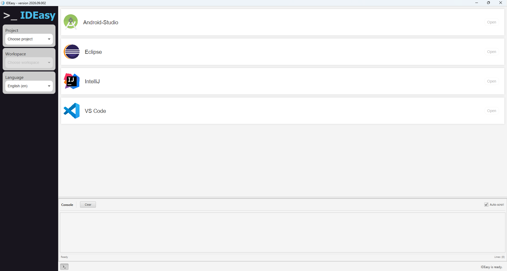

= IDEasy GUI-Handbook

IDEasy provides a graphical interface (GUI) that lets you start one of the supported IDEs for a selected project and workspace.
This handbook explains the layout of the main window and how to use its parts.

== 1. Starting the GUI

To start the IDEasy GUI, use the `gui` commandlet:

[source,bash]
----
ideasy gui
----

The window is titled `IDEasy - version <version>`.

.Overview of the IDEasy GUI

== 2. Main window layout

The main window is made up of three areas:

* **Navigation panel** (left) – there you can choose the project, the workspace and the language.
* **Content area** (center) – a tab area with the *IDEs* tab.
The *Console* can be shown below it.
* **Status bar** (bottom) – shows the current status and a button to toggle the console.

== 3. Selecting a project and workspace

The project and workspace you work in are selected in the navigation panel on the left.

. Select a project in the *Project* dropdown (the dropdown-button `Choose project`).
The available projects are the ones found in your `IDE_ROOT` directory.
. Select a workspace in the *Workspace* dropdown (the dropdown-button `Choose workspace`).
The workspaces shown are the workspace folders of the selected project.

[NOTE]
====
* The *Workspace* dropdown is disabled until a project is selected.
* If the project has a `main` workspace, it is selected automatically.
* Selecting a workspace switches the IDEasy context.
From then on, everything you do in the GUI (for example starting an IDE) runs in the selected project/workspace.
====

== 4. Starting an IDE

The *IDEs* tab lists the supported IDEs, each with an *Open* button:

* Android Studio
* Eclipse
* IntelliJ
* VS Code

. Make sure a project and a workspace are selected (see the previous section).
. Click *Open* on the IDE you want to start.
IDEasy runs the corresponding IDEasy commandlet for that IDE in the selected project/workspace context and starts the IDE for that workspace.

[NOTE]
====
The *Open* buttons stay disabled until both a project and a workspace are selected.
An IDE has to be available for the workspace first; IDEasy installs and prepares it when necessary before starting it.
====

== 5. Console

The console shows the log output produced by IDEasy while it works, for example while an IDE is being prepared or started.

* The console opens automatically when you start an IDE.
You can also show or hide it at any time with the console button in the status bar (tooltip: `Toggle console`).
* The console has a `Clear` button (clears the output) and an `Auto-scroll` checkbox (on by default, keeps the view on the newest line).
* The number of displayed lines is shown as `Lines: <n>` at the bottom.

Log entries are color-coded by severity: errors are red, warnings are orange, and information, debug and trace messages are shown in grey shades.

== 6. Status bar

The status bar at the bottom reports what is happening:

* When IDEasy is idle it shows `IDEasy is ready.`.
* While a task is running it shows the task name together with a progress indicator, for example `Downloading [ 128393700 / 377592420 Mib]`, and a progress bar.

== 7. Changing the language

The *Language* dropdown (the dropdown-button `Choose language`) lets you change the display language of the GUI.
Languages are shown as `Language (code)`, for example `English (en)`.
Selecting a language applies it to the GUI immediately.

== 8. Quitting the GUI

Closing the window quits the GUI.
