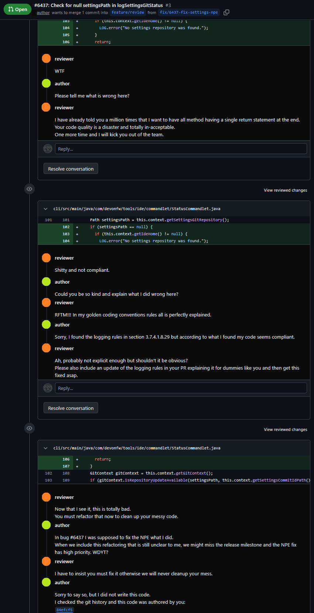
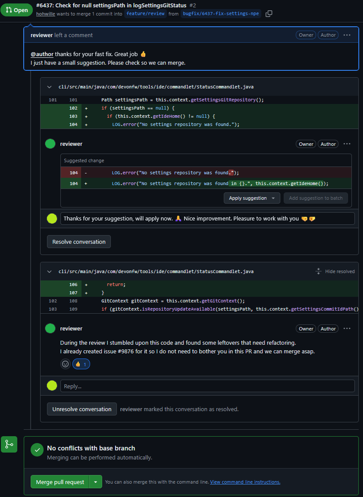

:toc:
toc::[]

== Constructive code-reviews

This guide gives best practices for code-reviews and is intended to be considered and used even beyond this IDEasy project.

Decades ago when remote work just started we may have observed a code-reviewer was some technical lead acting as dictator and god of the project sitting on his throne and dropping lots of WTFs at poor developers receiving the negative feedback.
Translated to today's tooling this could look like this:

Instead, we propose a positive and constructive code-review where the code author and the reviewer are working happily together as one team with the same goal:
Make the project better day by day in small steps with low risk changes and great quality assurance.

=== Terms

We will use the following terms in this context:

* _change_
+
A diff/path changing the code provided as link:pull-request.adoc[pull-request] (PR) aka merge-request (MR)
* _author_
+
The person who created the change.
* _reviewer_
+
The person who reviews the change and gives feedback to the author.

=== Pre-requisites for code quality

As a pre-requisite the entire team is responsible to establish a setup supporting good code quality:

* *CI*: Establish proper infrastructure, setup, and processes so that changes are automatically verified (continuous integration).
This includes checks to verify the quality of the changes.
Those typically include compiling, linting, automated testing, CVE checking, secrets scanning, etc.
* *Automation is key*:
The more checks and process-steps are automated, the less hustle for humans participating in the process.
Therefore, be lazy and implement automated workflows checking basic requirements and rules for your code quality.
Instead of writing documentation that e.g. code should be formatted in a special way or that method names need to follow some regex, simple automate a check.
* *Balance your checks*:
Find a good balance for automated checks between being too lax and overengineered formalism.
Especially only include build-breakers for rules that do not cause false-positives.
* *Commit-hook*:
Consider to provide a link:commit-hook.adoc[commit-hook] as harness for developers (and AI agents) so a commit fails already locally when basic checks are not met.
* *IDE automation*:
Configure your IDE and AI tools automatically to avoid mistakes.
When you save your code file in your preferred IDE, ensure it automatically gets formatted so the developer cannot get it wrong.
https://github.com/devonfw/IDEasy[IDEasy] perfectly supports your team in this regard.
* *Fight for quality*:
Projects often get pressure from time and budget constraints, business demands and managers may push you forward.
Still one thing is for sure:
If you start to sacrifice quality for pace and quick-wins, you will get into much bigger trouble later.
Fight for code quality but still keep a good pragmatism avoiding dogmatism and perfection.
* *DoD*:
Specify a `definition-of-done` (DoD) with all requirements a change needs to satisfy.
The DoD needs to be accepted and supported by the entire team.
* *Minimize issues and changes*:
Try to keep the number of open issues and changes assigned to you at a bare minimum (see Kanban).
This helps for mindfulness and makes it easy to focus on the work you need to do.
What is your status if you have hundreds of open issues assigned and what are you working on now and next?

=== Best practices for managing code-changes and core-reviews

. *Fast feedback*:
The earlier a developer gets feedback if he does something wrong or odd, the better.
Ideally you get feedback inside your IDE while you are typing.
Projects where the author gets feedback from the reviewer months after he created the change will sooner or later get big trouble.
Meanwhile, the same author may have repeated the same mistakes or antipatterns in multiple other places.
. *Positive feedback*:
A code-review may have the tendency to focus on the problems and surely the main task is to find out what may be wrong or should be improved.
However, as a reviewer explicitly highlight positive aspects in the summary or give praises for good solutions even in code comments that you immediately resolve.
. *Constructive feedback*:
Nowadays, review tools allow reviewers to make suggestions for code changes.
Make use of that feature to propose small improvements.
This is sometimes even easier and faster than explaining the desired improvement in plain text and especially avoids misunderstandings and supports resolving the review-comment fast.
Even when a technical suggestion is not suitable, help to provide a way to resolve the found problem or flaw with design proposals and code snippets.
Consider to explain and motivate your suggestion so the author can understand the problem of his original code or why your suggested idea improves the code.
. *Precise feedback*:
Be precise and include contextual information to avoid misunderstandings.
Try to be concrete and specific to make it easy to address your review concern and take action to resolve it.
. *Personal feedback*:
Time-pressure, different availabilities, and time-zones all lead to remote reviews where the reviewer and the author communicate asynchronous.
While this is helpful, it can also lead to inefficient review ping-pongs.
If there is more complex review-feedback, always (additionally) consider to plan a review-meeting where reviewer and author discuss the changes live together - yes, ideally in the same room (or at least with screensharing).
This can sometimes speed up the process to get a complex change merged significantly compared to async review comments.
. *Focus on the topic*:
A change needs to be associated with an issue (bug, feature, story, etc.) and focus on it.
Therefore, if the reviewer browsing the diff and spotting an unrelated code problem will *_not_* add a review comment asking the author of the change to fix it nor ignore it, but instead create a new issue for the new problem.
The reviewer is more than welcome to put a link to the new issue in a review comment but then set it to resolve preventing to block the change from being merged due to the new issue.
. *Small changes*:
Design your issues and changes as small as possible.
A small change is easy to understand, review, rebase, and merge.
The bigger your change gets, the longer it takes to get reviewed and finally merged.
Also, this causes higher likely-hood of merge conflicts as well as risks of missing out problems in the review.
So rather create multiple smaller issues and changes rather than few big ones.
. *Maintain your change*:
Whenever such check fails, the change is not ready and the author is in charge to fix it.
Only when all checks succeed the review can start.
Even then changes coming into the target branch may break it.
Take responsibility to maintain your change and keep it clean and green.
. *Empower the team*:
Empower the entire team to do reviews in order to avoid bottlenecks.
Surely good reviews need experience but how can you collect experience and become a good reviewer unless you start doing reviews?
Establish coaching of less experienced team members for reviews in pair-review sessions.
Also, consider letting them do a first review, a more experienced member doing a second one so he can see what they might have missed, and they can learn from it.
A technical lead with a large developer team who dictates all reviews is on the wrong track.
He will be the bottleneck of all reviews slowing down the progress, or he will end up under such pressure that he cannot keep the quality high and take the needed time to review everything carefully.
. *Be team-player*:
First focus on your tasks and issues.
But second, also observe if something got stuck and see if you can help out.
E.g. some team-member may be sick and his important change gets stuck and will not make it for the release if you do not step in.
Surely a project will have some management, and you should align with that so do not act without informing or getting permission.
But be a proactive team-player and support your project-lead, scrum-master, etc. watching them drowning in workload.
Also, if you are an experienced developer and in a review you see some bigger problems, consider creating a change (MR/PR) for their change, where you propose an improvement so they can learn from it.
Then they still stay in control of their change and what suggestion to integrate and how.
. *Utilize AI*:
Use the power of AI to speed up your progress creating a change, but also to review and challenge your ideas, design, and changes.
If you cannot access another team-member to get feedback the AI is always available to check and improve your result.
Make use of that potential to increase quality and boost your career.
Consider creating a prompt or skill for reviews shared with your team via version control (e.g. git).
. *Use advanced review tools*:
In the first place reviews are typically done in the browser what feels natural when also browsing issues.
However, doing complex reviews and start coding for suggestions in the text area of the browser is leading you on the wrong track.
Learn how you can integrate reviews into your IDE via plugins and get auto-completion, AI support, testing, etc. directly into your review process.

=== Links

For further reading also consider the following links:

* https://pmc.ncbi.nlm.nih.gov/articles/PMC12702561[Tips and tricks for writing constructive peer reviews]
